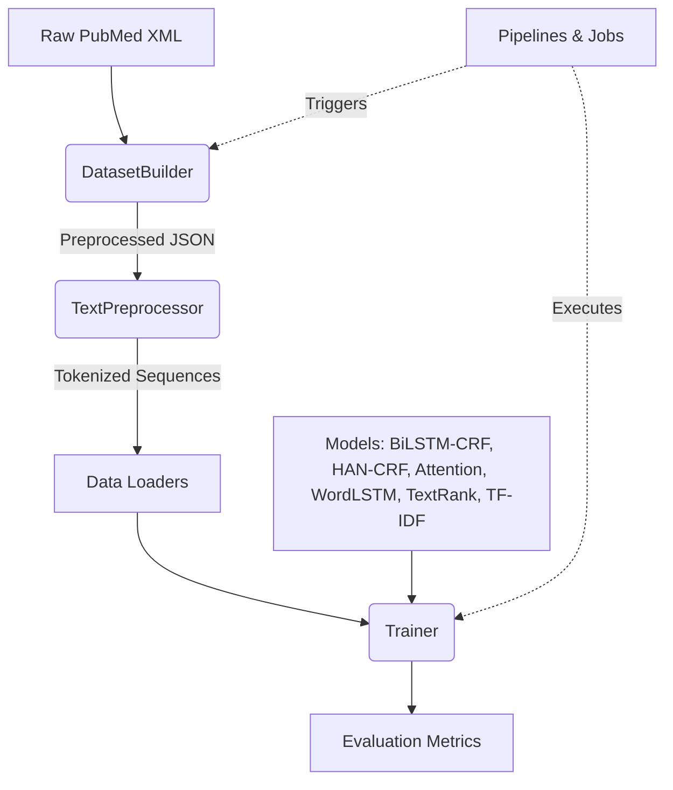

# NLP Keyphrase Identify (NLP_KPIdentify)

A modular Natural Language Processing (NLP) pipeline for identifying keyphrases from PubMed articles using Neural Models and SciSpacy.

## Setting Environment
```bash
conda activate cdss
python -c "import nltk; nltk.download('stopwords');nltk.download('punkt');"
python -m spacy download en_core_web_sm
pip install https://s3-us-west-2.amazonaws.com/ai2-s2-scispacy/releases/v0.5.4/en_ner_bc5cdr_md-0.5.4.tar.gz
pip install https://s3-us-west-2.amazonaws.com/ai2-s2-scispacy/releases/v0.5.4/en_core_sci_lg-0.5.4.tar.gz

python -m spacy validate
✔ Loaded compatibility table

================= Installed pipeline packages (spaCy v3.7.5) =================
ℹ spaCy installation:
/Users/rohangoli/miniforge3/envs/cdss/lib/python3.9/site-packages/spacy

NAME               SPACY            VERSION                            
en_ner_bc5cdr_md   >=3.7.4,<3.8.0   0.5.4   ✔
en_core_web_sm     >=3.7.2,<3.8.0   3.7.1   ✔
en_core_sci_lg     >=3.7.4,<3.8.0   0.5.4   ✔


```

## Running FastAPI
```bash
uvicorn api:app --reload
```

## Architecture

We use a modular, Object-Oriented design that decouples data processing, model architectures, training logic, and high-level experiments.



### Directory Structure
- `src/nlp/data/`: Data loading, preprocessing (`TextPreprocessor`), and synthetic dataset generation (`DatasetBuilder`).
- `src/nlp/models/`: Neural Network and statistical architectures (`BiLSTM_CRF`, `HAN_CRF`, `LanguageModel`, `Attention`, `TextRank`, `TF-IDF`).
- `src/nlp/training/`: Reusable training loops (`Trainer`).
- `src/nlp/evaluation/`: Evaluation metrics (`seqeval` and confusion matrices).
- `src/nlp/experiments/`: High-level experiment scripts (`ScispacyExperiment`, `GNAExperiment`).
- `src/nlp/jobs/`: Trigger and pipeline scripts (`metamap_pipeline.py`, `gna_pipeline.py`, `data_insertion.py`, `nlp_operations.py`).
- `src/nlp/configs/`: Configuration files (e.g., SciSpacy `.cfg`).
- `src/nlp/utils/`: Generic utilities (e.g., I/O).
- `outputs/models/`: Interim trained models and weights.

## Running Pipelines

**1. NLP Global Neural Attention Pipeline (Replacement for `mainV2.py`):**
The `gna_pipeline.py` script replaces the legacy `mainV2.py` and supports all the previous operational modes for both standard `bilstm_crf` and hierarchical `han_crf` models:
- `train`: Train the selected model.
- `test`: Test on the test set.
- `testGS`: Test on Gold Standard datasets.
- `predict`: Run prediction mode (used by FastAPI).
- `createData`: Generate synthetic JSON datasets from PubMed XML.
- `preTrain`: Pretrain the WordLSTM language model.

```bash
# 1a. Train the default BiLSTM-CRF model
python src/nlp/jobs/gna_pipeline.py --model bilstm_crf --mode train --epochs 20 --batchSize 64

# 1b. Train the Hierarchical Attention (HAN-CRF) model
python src/nlp/jobs/gna_pipeline.py --model han_crf --mode train --epochs 20 --batchSize 64

# 2a. Test the BiLSTM-CRF model
python src/nlp/jobs/gna_pipeline.py --model bilstm_crf --mode test

# 2b. Test the HAN-CRF model
python src/nlp/jobs/gna_pipeline.py --model han_crf --mode test

# 3. Test on Gold Standard datasets
python src/nlp/jobs/gna_pipeline.py --mode testGS

# 4. Generate synthetic datasets
python src/nlp/jobs/gna_pipeline.py --mode createData --minSentences 3 --filterKP True

# 5. Pretrain language model
python src/nlp/jobs/gna_pipeline.py --mode preTrain -seqLen 5
```

**2. MetaMap Processing:**
```bash
python src/nlp/jobs/metamap_pipeline.py
```

**3. Data Insertion:**
```bash
python src/nlp/jobs/data_insertion.py --type gs
```

**4. NLP Operations (Train / Process):**
```bash
python src/nlp/jobs/nlp_operations.py --op train
```

## Multi-Platform Execution

The codebase is optimized for seamless deployment across multiple platforms using custom runtime configurations:

### 1. Apple Silicon M1 Pro (Local GPU)
Run the pipeline with PyTorch MPS (Metal Performance Shaders) acceleration:
```bash
# Make the helper executable
chmod +x scripts/run_local_m1.sh

# Run training/testing (forward any custom arguments)
./scripts/run_local_m1.sh --mode train --epochs 20
```

### 2. Remote Machine with NVIDIA GPU (Docker Container) and SSHFS to MacOS Code Repo
If your source code is mounted over SSHFS, building directly with `docker build .` can generate heavy network traffic because Docker must read the full build context from the mount.

Use a local staging directory on the remote machine, then build from that local path:

```bash
# One-time: make helper executable
chmod +x scripts/build_local_context.sh

# Build from local filesystem staging directory (default: ~/.cache/nlp_kp_build)
./scripts/build_local_context.sh

# Optional overrides
# IMAGE_NAME=nlp_kp_dev LOCAL_BUILD_DIR=/var/tmp/nlp_kp_build ./scripts/build_local_context.sh

## Install NVIDIA Container Toolkit https://docs.nvidia.com/datacenter/cloud-native/container-toolkit/latest/install-guide.html

# Run container with GPU support
docker run --rm --gpus all \
  -v $(pwd)/outputs:/app/outputs \
  nlp_kp --device cuda --mode train --epochs 20
```

### Create Conda GPU 
```bash
conda env create -f cdss-gpu.yaml --environment-spec environment.yml
conda activate cdss-gpu
python -c "import torch; print(torch.cuda.is_available(), torch.version.cuda)"
```

For maximum throughput during long training runs, consider writing outputs to a local directory on the remote host (for example, `/var/tmp/nlp_kp_outputs`) and syncing back to SSHFS only when needed.

### 3. Clemson's Palmetto Supercomputer (PBS / Slurm Job Queue)
Submit your job to the cluster scheduler using one of the pre-configured job scripts:
* **PBS Pro Scheduler:**
  ```bash
  qsub scripts/cluster/submit_job.pbs
  ```
* **Slurm Scheduler:**
  ```bash
  sbatch scripts/cluster/submit_job.slurm
  ```

For more comprehensive instructions and custom cluster configurations, please refer to the detailed [walkthrough](file:///Users/rohangoli/.gemini/antigravity-ide/brain/b28e1982-b25c-468d-b676-e5b515110735/walkthrough.md).

