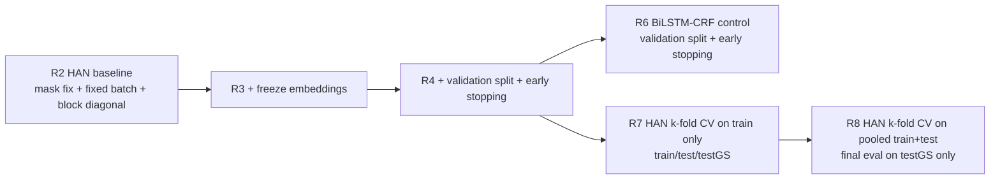
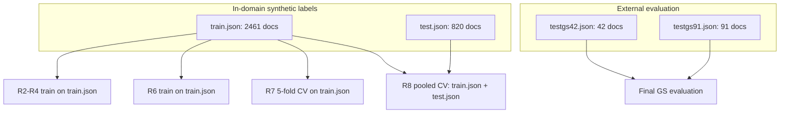

# Quick Research Summary: R2-R8

## Objective
Evaluate HAN-CRF under incremental controls (mask fix, freezing, validation/early stop, k-fold CV) and compare against BiLSTM-CRF control, with emphasis on external generalization to GS42 and GS91.

## Experimental Flow

## Data Regimes and Splits

## Mathematical Representation
Training objective for sequence tagging with CRF:

$$
\mathcal{L}(\theta) = -\sum_{(x,y) \in \mathcal{D}_{train}} \log p_\theta(y \mid x)
$$

Validation-based model selection and early stopping:

$$
e^* = \arg\min_e \; \mathcal{L}_{val}^{(e)}, \quad
\text{stop when } \mathcal{L}_{val} \text{ does not improve for } p \text{ epochs}
$$

K-fold score aggregation (metric $m$ over $K=5$ folds):

$$
\bar{m} = \frac{1}{K}\sum_{k=1}^{K} m_k,
\qquad
\sigma_m = \sqrt{\frac{1}{K}\sum_{k=1}^{K}(m_k-\bar{m})^2}
$$

Layer freezing used in HAN experiments where enabled:

$$
\frac{\partial \mathcal{L}}{\partial E} = 0
\quad \text{(embedding matrix frozen)}
$$

## Configuration and Layer Freezing
- HAN block-diagonal sentence attention mask: enabled in R2, R3, R4, R7, R8.
- HAN fixed batch mode: enabled in R2, R3, R4, R7, R8.
- Embedding freezing: enabled in R3, R4, R7, R8; not enabled in R2.
- BiLSTM-CRF control in R6 has no HAN embedding-freeze switch.

## Tabular Comparison (Samples, Metrics, Notes)
| Exp | Model | Train samples used | Validation samples used | Test samples used | GS42/GS91 samples | Layer freezing | SeqEval F1 Test (%) | SeqEval F1 GS42 (%) | SeqEval F1 GS91 (%) | Notes |
|---|---|---:|---:|---:|---:|---|---:|---:|---:|---|
| R2 | HAN-CRF | 2461 | 0 | 820 | 42 / 91 | No | 75.39 | 42.52 | 55.67 | Baseline after mask/vocab fix, no early stop |
| R3 | HAN-CRF | 2461 | 0 | 820 | 42 / 91 | Yes (embeddings) | 75.77 | 41.77 | 54.26 | Freeze embeddings only |
| R4 | HAN-CRF | 2215 | 246 | 820 | 42 / 91 | Yes (embeddings) | 75.87 | 43.79 | 53.29 | Validation split 0.1 + early stop (best epoch 4) |
| R6 | BiLSTM-CRF | 2215 | 246 | 820 | 42 / 91 | N/A (HAN-only switch) | 75.70 | 42.41 | 52.31 | Control with validation + early stop (best epoch 3) |
| R7 | HAN-CRF (5-fold CV on train.json) | 1968-1969 per fold | 492-493 per fold | 820 | 42 / 91 | Yes (embeddings) | 75.35 +/- 0.36 | 41.75 +/- 0.64 | 52.45 +/- 0.44 | Aggregate across 5 folds |
| R8 | HAN-CRF (5-fold CV on pooled train+test) | 2624-2625 per fold | 656-657 per fold | 0 (final eval excludes in-domain test) | 42 / 91 | Yes (embeddings) | N/A | 42.67 +/- 0.38 | 53.41 +/- 0.30 | Pooled in-domain CV; final evaluation on GS only |

## Key Findings
- Best Test F1 among runs with test evaluation: R4 at 75.87 (R7 mean lower at 75.35).
- Best GS42 F1: R4 at 43.79.
- Best GS91 F1: R2 at 55.67.
- R8 (pooled CV + GS-only final eval) improved over R7 CV means on external sets:
  - GS42: +0.92 (42.67 vs 41.75)
  - GS91: +0.96 (53.41 vs 52.45)
- R8 still trails R2 on GS91 by 2.26 points.

## Experiment Notes
- R2-R4 and R6 evaluated on both in-domain test and external GS datasets.
- R7 used k-fold validation on train.json only, then still reported in-domain test and GS.
- R8 used the stricter external-eval protocol suggested by user intent: pooled in-domain data for CV model selection, GS42/GS91 as final targets.

## Source Artifacts
- outputs/results/rtx2000_blackwell/2026/05/29/r2-han-crf-maskfix-fixedblock.md
- outputs/results/rtx2000_blackwell/2026/05/29/r3-han-crf-frozenemb-fixedblock.md
- outputs/results/rtx2000_blackwell/2026/05/29/r4-han-crf-frozenemb-val-es-fixedblock.md
- outputs/results/rtx2000_blackwell/2026/05/29/r6-bilstm-crf-val-es-control.md
- outputs/results/rtx2000_blackwell/2026/05/29/r7-comparison-summary.md
- outputs/results/rtx2000_blackwell/2026/05/29/r8-pooled-cv-gs-only-summary.md
