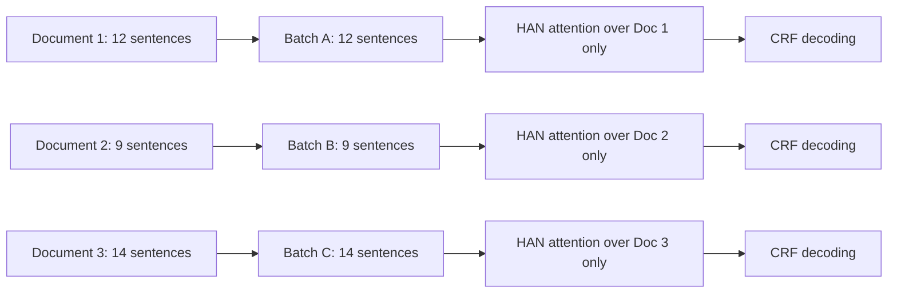
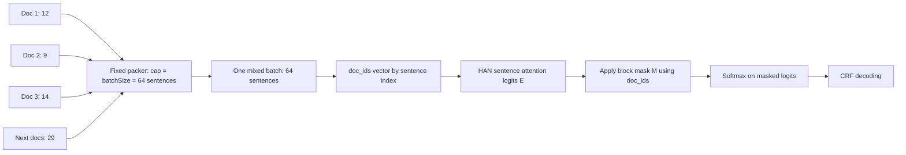
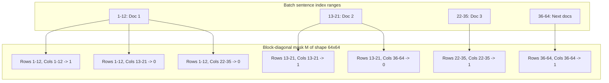

# Research Summary: HAN-CRF with Fixed Batching + Block-Diagonal Attention

## Objective
This study evaluates whether HAN-CRF can be accelerated by switching from document-wise dynamic batching to fixed-size sentence batching, while preserving document-level context using block-diagonal attention masking.

Compared setups:
- Baseline: document-wise batching (one document per batch)
- Proposed: fixed sentence-cap batching with block-diagonal attention mask

Source runs:
- `han-crf-batch-doc.md`
- `han-crf-batch-fixed-block-diag-attn.md`

## Block-Diagonal Attention Concept
In fixed batching, sentences from multiple documents are packed into one batch. Without constraints, sentence attention may leak across documents.

To prevent this, we apply a block-diagonal mask based on document IDs.

Let:
- $i$ be query sentence index
- $j$ be key/value sentence index
- $d(i)$ be document ID of sentence $i$

Mask definition:
$$
M_{ij} = \begin{cases}
1, & d(i)=d(j)\\
0, & d(i)\neq d(j)
\end{cases}
$$

Attention logits are masked so only same-document interactions remain:
$$
\tilde{e}_{ij} = e_{ij} + (1 - M_{ij})\cdot(-\infty)
$$
$$
\alpha_{ij} = \frac{\exp(\tilde{e}_{ij})}{\sum_k \exp(\tilde{e}_{ik})}
$$

This keeps document-level attention semantics while enabling much larger, hardware-efficient batches.

## Architectural Differences: Document vs Fixed Batch

## Architectural Diagrams

### Document Batching (Baseline)



### Fixed Batching + Block-Diagonal Mask (Proposed)



### BatchSize 64 Example With Explicit Ranges



In this 64-sentence batch, attention is allowed only inside each diagonal block (same document region). Off-diagonal regions are masked to 0, so no cross-document attention contributes to the final weights.

### Heatmap-Style Mask Intuition

The mask can also be viewed exactly like your heatmap: bright cells are allowed attention (1), dark cells are blocked (0).

For an illustrative mini-batch with document sentence counts `[3, 2, 6]`, we have 11 total sentence positions:

- Q/K 0-2 belong to Doc 1
- Q/K 3-4 belong to Doc 2
- Q/K 5-10 belong to Doc 3

So the mask is block-diagonal:

```text
  K0 K1 K2 K3 K4 K5 K6 K7 K8 K9 K10
Q0    1  1  1  0  0  0  0  0  0  0   0
Q1    1  1  1  0  0  0  0  0  0  0   0
Q2    1  1  1  0  0  0  0  0  0  0   0
Q3    0  0  0  1  1  0  0  0  0  0   0
Q4    0  0  0  1  1  0  0  0  0  0   0
Q5    0  0  0  0  0  1  1  1  1  1   1
Q6    0  0  0  0  0  1  1  1  1  1   1
Q7    0  0  0  0  0  1  1  1  1  1   1
Q8    0  0  0  0  0  1  1  1  1  1   1
Q9    0  0  0  0  0  1  1  1  1  1   1
Q10   0  0  0  0  0  1  1  1  1  1   1
```

This is the same structure as your image: three bright diagonal blocks (sizes 3x3, 2x2, 6x6) and dark off-diagonal regions.

#### Reproducible Plot Snippet

```python
import numpy as np
import matplotlib.pyplot as plt

# Example doc sentence counts corresponding to the heatmap above.
doc_sizes = [3, 2, 6]
doc_ids = np.concatenate([np.full(n, i) for i, n in enumerate(doc_sizes)])
mask = (doc_ids[:, None] == doc_ids[None, :]).astype(float)

fig, ax = plt.subplots(figsize=(9, 7))
im = ax.imshow(mask, cmap="cividis", vmin=0.0, vmax=1.0)

ax.set_title("Document Mask")
ax.set_xlabel("Key Tokens")
ax.set_ylabel("Query Tokens")

ax.set_xticks(np.arange(mask.shape[1]))
ax.set_yticks(np.arange(mask.shape[0]))
ax.set_xticklabels([f"KV{i}" for i in range(mask.shape[1])])
ax.set_yticklabels([f"Q{i}" for i in range(mask.shape[0])])

ax.tick_params(top=True, bottom=False, labeltop=True, labelbottom=False)
ax.set_xticks(np.arange(-0.5, mask.shape[1], 1), minor=True)
ax.set_yticks(np.arange(-0.5, mask.shape[0], 1), minor=True)
ax.grid(which="minor", color="black", linestyle="-", linewidth=1.5)
ax.tick_params(which="minor", bottom=False, left=False)

plt.colorbar(im, ax=ax)
plt.tight_layout()
plt.show()
```

### 1) Data Packing
- Document batching:
  - Each batch contains sentences from exactly one document.
  - Number of batches is roughly number of documents.
  - Highly variable batch size by document length.
- Fixed batching:
  - Sentences from multiple documents are packed until batch cap (`batchSize`) is reached.
  - Fewer total batches and better GPU utilization.
  - Requires document index tensor (`doc_ids`) and attention mask.

### 2) Attention Scope
- Document batching:
  - All sentences in batch are from one document, so attention is naturally document-local.
- Fixed batching:
  - Attention would be cross-document by default.
  - Block-diagonal mask explicitly restores document-local attention.

### 3) Training Loop Behavior
- Document batching:
  - Many small/irregular batches and higher framework/kernel launch overhead.
- Fixed batching:
  - Fewer, denser batches and significantly better throughput.

## Mathematical Formula Differences

### Baseline (doc-wise)
For each document with $n_d$ sentences:
$$
\alpha^{(d)} = \text{softmax}(E^{(d)}) \quad \text{where } E^{(d)} \in \mathbb{R}^{n_d \times n_d}
$$

No explicit cross-document terms exist because a batch contains one document.

### Fixed + block mask
For a mixed batch with $N$ total sentences from multiple documents:
$$
E \in \mathbb{R}^{N \times N}, \quad M \in \{0,1\}^{N \times N}
$$
$$
\alpha = \text{softmax}(E + (1-M)\cdot(-\infty))
$$

Equivalent interpretation:
- Computation is done on a larger packed matrix.
- Effective attention graph is sparse and block-diagonal by document.

## Performance Improvement (Observed)

### Training Throughput
From experiment logs:
- Document batching average epoch time: 209.45s
- Fixed+block average epoch time: 33.40s

Speedup:
$$
\text{speedup} = \frac{209.45}{33.40} \approx 6.27\times
$$

Total train runtime:
- Document batching: 4255.76s
- Fixed+block: 737.45s

### Accuracy / F1 Tradeoff
Observed SeqEval metrics:

| Dataset | Doc Batch F1 | Fixed+Block F1 | Delta |
|---|---:|---:|---:|
| Test | 76.01% | 75.54% | -0.47 pp |
| GS42 | 41.29% | 40.54% | -0.75 pp |
| GS91 | 54.46% | 53.71% | -0.75 pp |

Interpretation:
- Throughput gain is large (~6.27x per epoch).
- Performance drop is modest (<1 percentage point on reported sets).
- This is a favorable systems-performance tradeoff for iterative experimentation.

## Conclusion
Fixed sentence batching with block-diagonal attention successfully preserves document-local attention constraints while dramatically improving training speed.

For this setup, the approach provides a strong efficiency gain with limited metric degradation, making it suitable as the default experimental training mode for HAN-CRF on GPU.

## Recommended Next Validation
- Repeat both settings across multiple random seeds and report mean ± std.
- Add one controlled ablation:
  - fixed batching without mask vs fixed batching with block mask
  - to isolate mask contribution from batching contribution.
