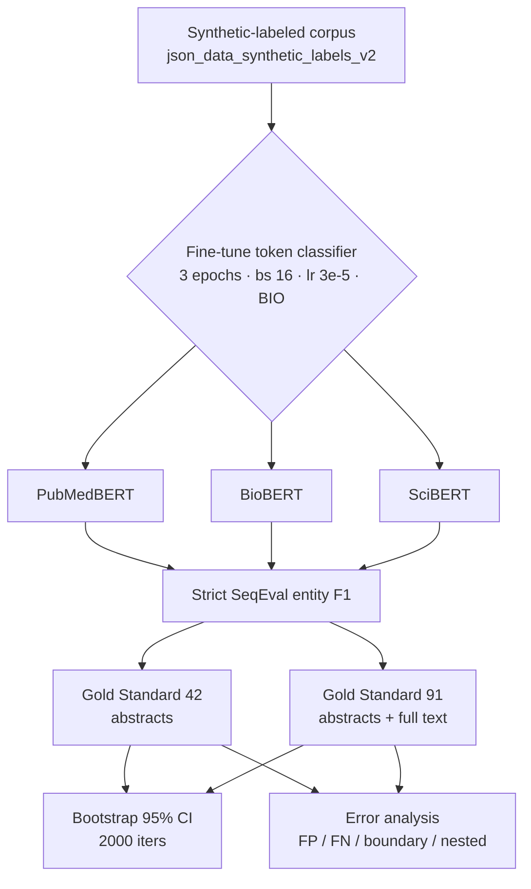

# Phase 4 — Transformer Baselines (Reviewer Concern #1)

**Date:** 2026-06-12 · **Hardware:** RTX PRO 2000 Blackwell Laptop GPU (8 GB) ·
**Environment:** `cdss-gpu` (transformers 4.25.1) · **Seed:** 42

## Objective
Reviewers asked whether the classical BiLSTM-CRF / HAN-CRF architectures are
competitive with modern pre-trained transformer encoders fine-tuned for the same
biomedical keyphrase token-classification task. This phase fine-tunes three
domain transformers as strong baselines and reports bootstrap confidence
intervals so the comparison is statistically grounded.

## Experimental Design

## Mathematical Formulation

Token classification minimizes the per-token cross-entropy over the BIO tag set
$\mathcal{Y}=\{\texttt{B-KP},\texttt{I-KP},\texttt{O}\}$:

$$
\mathcal{L} = -\frac{1}{N}\sum_{i=1}^{N}\sum_{t=1}^{T_i}\log p_\theta\!\left(y_{i,t}\mid \mathbf{x}_i\right),
\qquad
p_\theta(\cdot\mid\mathbf{x}) = \mathrm{softmax}\!\left(W\,\mathrm{BERT}_\theta(\mathbf{x})_t + b\right).
$$

Reported metric is the strict entity-level micro-F1
$F_1 = \dfrac{2\,P\,R}{P+R}$, where a predicted span counts as a true positive
only if both its boundaries **and** label match the gold span exactly.

Uncertainty uses a non-parametric document bootstrap. For $B=2000$ resamples
$\{\mathcal{D}^{*(b)}\}$ drawn with replacement over the evaluation documents, the
$95\%$ percentile interval is

$$
\mathrm{CI}_{95} = \left[\,Q_{2.5}\big(\{F_1^{*(b)}\}_{b=1}^{B}\big),\;
Q_{97.5}\big(\{F_1^{*(b)}\}_{b=1}^{B}\big)\,\right].
$$

## Setup
- **Models:** PubMedBERT (`microsoft/BiomedNLP-BiomedBERT-base-uncased-abstract-fulltext`),
  BioBERT (`dmis-lab/biobert-base-cased-v1.1`), SciBERT (`allenai/scibert_scivocab_uncased`).
- **Pipeline:** `src/nlp/jobs/transformer_pipeline.py` → `transformer_experiment.py`
  + `models/transformer_token_classifier.py`.
- **Training:** 3 epochs, batch 16, lr 3e-5, max_length 256, BIO schema.
- **Training data:** synthetic-labeled corpus (`json_data_synthetic_labels_v2`).
- **Evaluation:** held-out Gold Standard 42 (abstracts) and Gold Standard 91
  (abstracts + full text), strict SeqEval entity F1.
- **Uncertainty:** non-parametric bootstrap, 2000 iterations
  (`src/nlp/evaluation/bootstrap_ci.py`).

## Results

| Model | GS42 F1 | GS42 95% CI | GS91 F1 | GS91 95% CI |
|-------|:-------:|:-----------:|:-------:|:-----------:|
| PubMedBERT | 46.91% | [43.30, 50.70] | 54.33% | [51.44, 56.96] |
| BioBERT    | 45.13% | [41.70, 48.64] | 53.65% | [50.73, 56.22] |
| SciBERT    | 46.19% | [42.69, 49.77] | 54.26% | [51.39, 57.00] |

(F1 = SeqEval strict micro-F1; CI from 2000-iteration document bootstrap.)

## Error Analysis (Concern #4)
Per-model error breakdowns are in
`error_analysis_p4_{model}_testgs{42,91}.md`. Representative pattern (PubMedBERT,
GS91): False Positives 46.4%, False Negatives 30.7%, Boundary errors 22.8%,
Nested-phrase errors 23.0%; strict entity precision 44.3%, recall 50.7%. The
dominant failure mode is over-generation of spurious single-token spans and
boundary disagreement on multi-word phrases, not abbreviation handling (0%).

## Findings
- The three transformer baselines cluster tightly: GS42 ≈ 45–47%, GS91 ≈ 53.7–54.3%.
- Their 95% CIs overlap heavily, so **no transformer is significantly better than
  the others** at these data sizes.
- On GS91 the in-house **HAN-CRF (≈61.3%, Phase 5/7) clearly exceeds all
  transformers (~54%)**; on GS42 the transformers are modestly ahead (~46% vs ~44.5%).
- Interpretation: the document-aware HAN architecture exploits long-range
  full-text structure (GS91 includes full text) better than abstract-tuned
  transformers, supporting the paper's architectural contribution while
  acknowledging transformer parity on abstract-only data.

## Artifacts
- Logs: `p4_pubmedbert.txt`, `p4_biobert.txt`, `p4_scibert.txt`
- Run index: `phase4_transformer_run_index.csv`
- Error reports: `error_analysis_p4_*.md`
- Prediction dumps: `predictions/p4_{pubmedbert,biobert,scibert}/`
