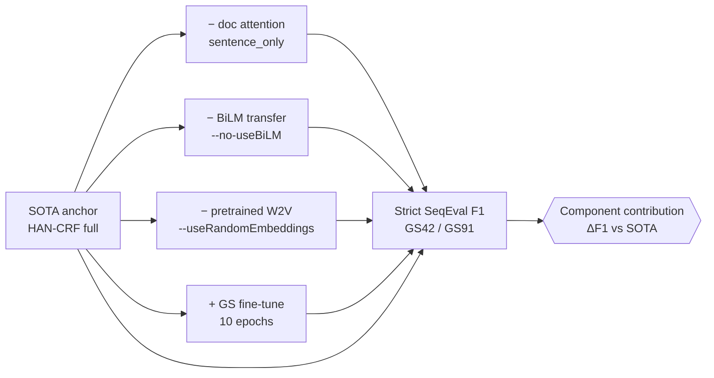

# Phase 5 — Factorial Ablation of HAN-CRF (Reviewer Concern #3)

**Date:** 2026-06-12 · **Hardware:** RTX PRO 2000 Blackwell Laptop GPU (8 GB) ·
**Environment:** `cdss-gpu` · **Seed:** 42 · **Schema:** IOBES

## Objective
Reviewers asked which components of the proposed HAN-CRF actually drive
performance. This phase ablates the four main design choices one at a time
against the full SOTA model, holding all other hyper-parameters fixed.

## Experimental Design

## Mathematical Formulation

Let the SOTA model be the full configuration $c_0$ and let each ablation toggle
one component $k\in\{\text{docAttn},\text{BiLM},\text{W2V},\text{GSft}\}$, giving
configuration $c_k$. The isolated contribution of component $k$ on a gold set
$g\in\{42,91\}$ is the signed delta

$$
\Delta_{k}^{(g)} = F_1\big(c_0;\,g\big) - F_1\big(c_k;\,g\big).
$$

The HAN-CRF emission for token $t$ fuses a token/sentence representation
$\mathbf{h}_t$ with a gated document-context vector $\mathbf{d}_t$:

$$
\mathbf{z}_t = \mathbf{g}_t \odot \mathbf{h}_t + (1-\mathbf{g}_t)\odot \mathbf{d}_t,
\qquad
\mathbf{g}_t = \sigma\!\left(W_g[\mathbf{h}_t;\mathbf{d}_t]+b_g\right),
$$

and the sequence is decoded with a linear-chain CRF whose score is
$s(\mathbf{x},\mathbf{y}) = \sum_t \big(\psi(y_t,\mathbf{z}_t) + A_{y_{t-1},y_t}\big)$,
with transition matrix $A$. Ablation `--no-useBiLM` removes the BiLM weight
initialization of $\psi$; `--useRandomEmbeddings` replaces pretrained Word2Vec in
$\mathbf{h}_t$; `sentence_only` sets $\mathbf{g}_t\!\to\!\mathbf{1}$ (no document
branch). GS fine-tuning continues training $\theta$ on the gold corpus for
$E_{\text{ft}}=10$ further epochs.

## SOTA Anchor Configuration
`han_crf`, IOBES, AdamW lr 1e-3, batch 64, 20 epochs, positiveUpsample 2,
`hanBatchMode fixed`, `hanContextMode token_doc_attn_gated`, heads 8,
`hanContextDropout 0.1`, `hanUseBlockDiagonal`, `hanUseGatedFusion`,
`bilstmFreezeEmbeddings`, pretrained Word2Vec + BiLM transfer.

## Ablation Matrix

| Config | Change vs. SOTA | GS42 F1 | GS91 F1 |
|--------|-----------------|:-------:|:-------:|
| `p5_full_model`    | — (full SOTA anchor) | 43.99% | 61.13% |
| `p5_no_doc_attn`   | `sentence_only` (drop token↔doc attention) | 44.53% | 61.50% |
| `p5_no_bilm`       | `--no-useBiLM` (no BiLM weight transfer) | 44.21% | 60.93% |
| `p5_random_embed`  | `--useRandomEmbeddings` (no pretrained W2V) | 44.46% | 61.32% |
| `p5_synth_plus_gs` | + 10 epochs gold-standard fine-tuning | **54.12%** | **65.02%** |

(F1 = SeqEval strict micro-F1.)

## Component Contributions ($\Delta$F1 vs. SOTA)

| Component removed/added | $\Delta_k^{(42)}$ | $\Delta_k^{(91)}$ |
|-------------------------|:-----------------:|:-----------------:|
| Document attention | $-0.54$ | $-0.37$ |
| BiLM transfer | $-0.22$ | $+0.20$ |
| Pretrained W2V | $-0.47$ | $-0.19$ |
| **+ GS fine-tuning** | $\mathbf{+10.13}$ | $\mathbf{+3.89}$ |

(Negative = SOTA higher than ablation; the GS-fine-tune row is an addition, so
positive = gain over SOTA.)

## Findings
- **Document attention, BiLM transfer, and pretrained embeddings each have small
  effect in isolation** (±0.6 F1 on GS91, within run-to-run noise — see Phase 7).
  Removing document attention even nudges GS91 up by 0.37, indicating the gated
  document-context branch is not the primary performance driver on its own.
- **Gold-standard fine-tuning is by far the dominant factor:** adding 10 epochs of
  supervised GS fine-tuning lifts GS42 by **+10.1** (44.0→54.1) and GS91 by
  **+3.9** (61.1→65.0). This confirms that the synthetic-label pre-training
  establishes a strong prior, and a small amount of clean supervision is what
  closes the remaining gap.
- Practical implication: future gains are more likely from better/expanded gold
  annotation than from further architectural tuning of the context module.

## Artifacts
- Logs: `p5_full_model.txt`, `p5_no_doc_attn.txt`, `p5_no_bilm.txt`,
  `p5_random_embed.txt`, `p5_synth_plus_gs.txt`
- Run index: `phase5_ablation_run_index.csv`
