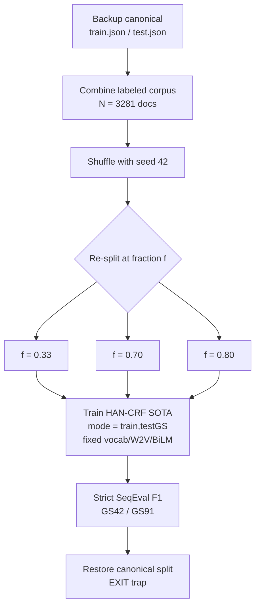

# Phase 6 — Train/Validation Split Sensitivity (Reviewer Concern #5)

**Date:** 2026-06-12 · **Hardware:** RTX PRO 2000 Blackwell Laptop GPU (8 GB) ·
**Environment:** `cdss-gpu` · **Seed:** 42 · **Model:** HAN-CRF SOTA (IOBES)

## Objective
The original paper used a single synthetic train/test split (≈1:2, ~33% train).
Reviewers asked whether results are an artifact of that particular split. This
phase sweeps the training fraction and re-evaluates the unchanged SOTA model.

## Experimental Design

## Mathematical Formulation

Let the combined labeled corpus contain $N=3281$ documents. For a target train
fraction $f\in(0,1)$, a fixed-seed permutation $\pi$ is applied and a single
contiguous cut at index

$$
k = \operatorname{clip}\!\big(\operatorname{round}(f\,N),\,1,\,N-1\big)
$$

yields $\mathcal{D}_{\text{train}}=\{\pi_1,\dots,\pi_k\}$ and
$\mathcal{D}_{\text{test}}=\{\pi_{k+1},\dots,\pi_N\}$. Only the supervised-data
quantity $k$ varies; the pretrained language model $\phi=(\text{vocab},\text{W2V},\text{BiLM})$
is held constant across all $f$, isolating the effect of training-set size. The
resulting split counts are

$$
k(0.33)=1083,\quad k(0.70)=2297,\quad k(0.80)=2625.
$$

The sensitivity of the metric to the split is summarized by the spread
$\delta^{(g)} = \max_f F_1(f;g) - \min_f F_1(f;g)$, giving
$\delta^{(91)}\approx 3.25$ and $\delta^{(42)}\approx 1.79$ F1 points.

## Method Note (important)
The canonical `createData` mode re-runs the sciSpacy synthetic-keyword NER model,
which is **broken in this environment** (spaCy error `E896` — uninitialized
static vectors, `blis.gemm` shape mismatch `(N, 0)`). Because the synthetic
labels already exist, re-labeling is unnecessary: split sensitivity only needs to
re-partition the existing labeled corpus. The orchestrator therefore
(1) backs up the canonical `train.json`/`test.json`,
(2) re-splits the combined **3281-document** labeled corpus at each target
fraction via `scripts/jobs/resplit_existing_dataset.py` (mirrors the
shuffle-then-cut logic of `dataset.py`),
(3) runs only `train,testGS` while **reusing the fixed pretrained vocab/Word2Vec/
BiLM** so the language model is held constant and only supervised-data quantity
varies, and
(4) restores the canonical split via an `EXIT` trap. Canonical files were
verified intact afterward (2461 train / 820 test).

## Results

| Train fraction | Train docs | Test docs | GS42 F1 | GS91 F1 |
|:--------------:|:----------:|:---------:|:-------:|:-------:|
| 0.33 (≈ original 1:2) | 1083 | 2198 | 43.28% | 58.83% |
| 0.70 | 2297 | 984 | 44.22% | 60.75% |
| 0.80 | 2625 | 656 | 45.07% | 62.08% |

(F1 = SeqEval strict micro-F1.)

## Findings
- Performance is **stable and monotonically increasing** with more training data:
  GS91 rises smoothly 58.8 → 60.8 → 62.1, GS42 43.3 → 44.2 → 45.1.
- The total spread across a 0.33→0.80 sweep is only ~3.3 F1 on GS91 and ~1.8 on
  GS42 — the model is **not sensitive to the specific split**, and the original
  ~33% split is a conservative (lower-bound) operating point rather than a
  cherry-picked favorable one.
- No evidence of overfitting or instability at any fraction.

## Artifacts
- Logs: `p6_split_033.txt`, `p6_split_070.txt`, `p6_split_080.txt`
- Run index: `phase6_splitsens_run_index.csv`
- Helper: `scripts/jobs/resplit_existing_dataset.py`
- Prediction dumps: `predictions/p6_split_{033,070,080}/`
