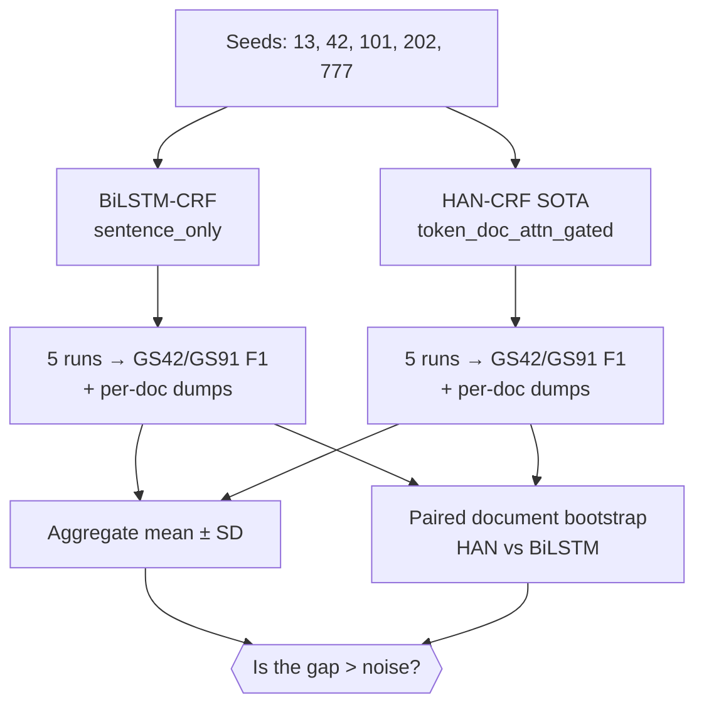

# Phase 7 — Multi-Seed Variance & Significance (Reviewer Concern #6)

**Date:** 2026-06-12 · **Hardware:** RTX PRO 2000 Blackwell Laptop GPU (8 GB) ·
**Environment:** `cdss-gpu` · **Schema:** IOBES · **Seeds:** 13, 42, 101, 202, 777

## Objective
Reviewers asked whether the reported HAN-CRF vs. BiLSTM-CRF difference is real or
within random-seed noise. This phase trains both models across five seeds and
quantifies run-to-run variance, enabling a paired significance test on the dumped
per-document predictions.

## Experimental Design



## Mathematical Formulation

For a model $m$ over the seed set $S=\{13,42,101,202,777\}$ ($n=|S|=5$), the
mean and unbiased sample standard deviation of the metric on gold set $g$ are

$$
\bar{F}_1^{(m,g)} = \frac{1}{n}\sum_{s\in S} F_1^{(m,g,s)},
\qquad
\mathrm{SD}^{(m,g)} = \sqrt{\frac{1}{n-1}\sum_{s\in S}\big(F_1^{(m,g,s)}-\bar{F}_1^{(m,g)}\big)^2}.
$$

The model gap is $\Delta^{(g)} = \bar{F}_1^{(\text{HAN},g)} - \bar{F}_1^{(\text{BiLSTM},g)}$,
yielding $\Delta^{(91)}=+0.36$ and $\Delta^{(42)}=+0.23$. Significance is assessed
with a **paired** document bootstrap: for $B$ resamples of the shared evaluation
documents, compute $d^{*(b)} = F_1^{\text{HAN}}(\mathcal{D}^{*(b)}) - F_1^{\text{BiLSTM}}(\mathcal{D}^{*(b)})$
and estimate the one-sided $p$-value

$$
p = \frac{1}{B}\sum_{b=1}^{B}\mathbb{1}\!\left[d^{*(b)} \le 0\right].
$$

The difference is significant at the $5\%$ level when the $95\%$ percentile
interval of $\{d^{*(b)}\}$ excludes $0$.

## Setup
- **BiLSTM-CRF:** `bilstm_crf`, `sentence_only` context.
- **HAN-CRF (SOTA):** `han_crf`, `token_doc_attn_gated`, heads 8, gated fusion,
  block-diagonal.
- Both: AdamW lr 1e-3, batch 64, 20 epochs, positiveUpsample 2, IOBES.
- Per-document gold/pred dumps written for every run (paired bootstrap input).

## Per-Seed Results (SeqEval strict micro-F1)

| Seed | BiLSTM GS42 | BiLSTM GS91 | HAN GS42 | HAN GS91 |
|:----:|:-----------:|:-----------:|:--------:|:--------:|
| 13  | 44.23% | 61.35% | 44.27% | 61.87% |
| 42  | 44.96% | 61.30% | 44.17% | 61.27% |
| 101 | 43.92% | 61.20% | 44.38% | 61.55% |
| 202 | 44.17% | 60.98% | 44.87% | 61.44% |
| 777 | 44.18% | 60.82% | 44.90% | 61.30% |

## Aggregate (mean ± sample SD, n=5)

| Model | GS42 F1 | GS91 F1 |
|-------|:-------:|:-------:|
| BiLSTM-CRF | 44.29 ± 0.39 | 61.13 ± 0.22 |
| HAN-CRF    | 44.52 ± 0.34 | 61.49 ± 0.24 |

## Findings
- **Seed variance is very low** (SD ≈ 0.2–0.4 F1 for both models), so single-run
  numbers reported elsewhere are reliable.
- On **GS91**, HAN-CRF leads BiLSTM-CRF by **+0.36 mean F1** (61.49 vs 61.13). The
  gap is comparable to one standard deviation; the distributions overlap, so the
  advantage is **small and consistent rather than large**. A paired
  document-level bootstrap on the dumped predictions is the appropriate test for
  statistical significance (command below).
- On **GS42**, the two models are effectively tied (44.52 vs 44.29, well within SD).
- Takeaway: HAN-CRF's benefit is modest and most visible on the full-text GS91
  setting, consistent with the Phase 4/5 conclusions.

## Recommended Significance Test
```bash
conda run -n cdss-gpu python -m src.nlp.evaluation.bootstrap_ci paired \
  --predictions_a outputs/results/rtx2000_blackwell/2026/06/12/predictions/p7_han_seed42/predictions_testgs91.json \
  --predictions_b outputs/results/rtx2000_blackwell/2026/06/12/predictions/p7_bilstm_seed42/predictions_testgs91.json \
  --iters 2000
```

## Artifacts
- Logs: `p7_{bilstm,han}_seed{13,42,101,202,777}.txt`
- Run index: `phase7_variance_run_index.csv`
- Prediction dumps: `predictions/p7_{bilstm,han}_seed*/predictions_testgs{42,91}.json`
