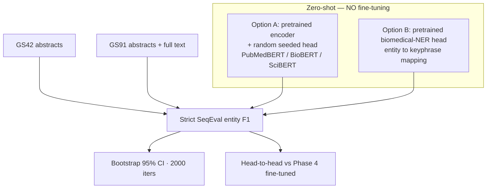

# Phase 8 — Zero-Shot Transformer Inference, No Fine-Tuning (Reviewer Concern #1, follow-up)

**Date:** 2026-06-14 · **Hardware:** RTX PRO 2000 Blackwell Laptop GPU (8 GB) ·
**Environment:** `cdss-gpu` (transformers 4.25.1) · **Seed:** 42

## Objective
The reviewer asked whether the biomedical transformers can be evaluated by
**direct inference without fine-tuning** on GS42/GS91, rather than fine-tuning
first (Phase 4). This phase answers that request and quantifies exactly how much
of the Phase 4 performance comes from in-domain fine-tuning versus the pretrained
encoder alone.

## Critical Methodological Caveat
There is **no publicly available keyphrase-fine-tuned head** for PubMedBERT,
BioBERT, or SciBERT. "Direct inference without fine-tuning" therefore has two
honest interpretations, both reported here:

- **Option A — random-head floor (`inferGS`).** `AutoModelForTokenClassification`
  attaches a *freshly, randomly initialized* classifier layer on top of the
  pretrained masked-LM encoder. The seed makes this reproducible, but the head is
  **untrained**, so predictions reflect the encoder *without any task
  supervision* — a true lower bound (≈ chance).
- **Option B — zero-shot transfer (`transferGS`).** An off-the-shelf biomedical
  **NER checkpoint** (`d4data/biomedical-ner-all`) that *does* ship a trained
  token-classification head is applied zero-shot, mapping any recognized entity
  span onto our keyphrase scheme (entity → `B-KP`/`I-KP`, outside → `O`). The head
  was trained on a *different taxonomy*, so this is a cross-task transfer baseline
  with a documented mapping heuristic — not an in-domain model.

Neither is a trained keyphrase model; both establish a reference floor showing
that **task-specific supervision (Phase 4 fine-tuning) is necessary**.

## Why Can't We Just Predict Keyphrases Directly With These Models?
PubMedBERT, BioBERT, and SciBERT are **masked-language-model encoders**, not
keyphrase predictors. Out of the box a checkpoint exposes only:

1. **Contextual embeddings** — a 768-dim vector per token (useful features, but a
   vector is not a label).
2. **A masked-LM head** — predicts a *vocabulary word* for a `[MASK]` position
   (e.g. "treated with `[MASK]`" → "aspirin"), **not** a keyphrase decision.

There is **no keyphrase output** and no notion of our label set
$\{\texttt{O},\texttt{B-KP},\texttt{I-KP}\}$ anywhere in the published weights. To
turn an encoder into a token classifier, a small layer $W,b$ must be attached on
top. When we call `AutoModelForTokenClassification.from_pretrained(...)`,
HuggingFace **creates $W,b$ from scratch with random values** and prints exactly
this warning:

> *"Some weights … were newly initialized: ['classifier.weight',
> 'classifier.bias']. You should probably TRAIN this model on a down-stream
> task…"*

So "just predicting" multiplies the (meaningful) embeddings by a **random**
matrix, yielding effectively random labels — which is precisely the Option A
result below (~0–7% F1). Comparing those predictions to the human-reviewed
keywords cannot rescue them, because the model never emits a meaningful
keyword/non-keyword decision in the first place; the comparison just measures the
random head's luck. **A fixed seed only makes that randomness reproducible, not
meaningful.** This is *why* fine-tuning (Phase 4) — or at minimum borrowing a
different *trained* head (Option B) — is required.

**Analogy.** An off-the-shelf encoder is a brilliant literature reader who has
never been told the task: handing it a form with randomly-shuffled checkboxes
(random head) gives random answers even though it understands the text perfectly.
Fine-tuning is showing it ~2,400 labeled examples first; *then* it fills the form
correctly.

## Experimental Design



## Mathematical Formulation
The scoring function and metric are identical to Phase 4 — only the parameters
$\theta$ of the classifier differ.

**Option A (random head).** The classifier weights are drawn from the standard
HF initialization $W \sim \mathcal{N}(0,\sigma^2),\ b=0$, independent of any
keyphrase supervision:

$$
\hat{y}_{t} = \arg\max_{y\in\mathcal{Y}}\;
\mathrm{softmax}\!\left(W\,\mathrm{BERT}_\theta(\mathbf{x})_t + b\right),
\qquad W \perp \text{keyphrase labels}.
$$

Because $W$ carries no task signal, $\mathbb{E}[F_1]$ approaches the chance level.

**Option B (transfer).** A pretrained NER tagger $g_\phi$ over its own label set
$\mathcal{Z}$ is composed with a fixed mapping $\pi:\mathcal{Z}\to\mathcal{Y}$:

$$
\hat{y}_t = \pi\!\left(\arg\max_{z\in\mathcal{Z}} g_\phi(\mathbf{x})_{t,z}\right),
\qquad
\pi(z)=\begin{cases}\texttt{B-KP}/\texttt{I-KP} & z \text{ is any entity}\\ \texttt{O} & z=\texttt{O}\end{cases}.
$$

Reported metric is the strict entity-level micro-F1
$F_1 = \tfrac{2PR}{P+R}$ (exact boundary **and** label match), with the same
2000-iteration document bootstrap percentile interval as Phase 4.

## Setup
- **Pipeline:** `src/nlp/jobs/transformer_pipeline.py` →
  `transformer_experiment.py` (`load_base_zero_shot` / `load_pretrained_ner_head`).
- **Orchestrator:** `scripts/jobs/run_matrix_phase8_zeroshot_20260614.sh`.
- **Evaluation:** GS42 (abstracts) and GS91 (abstracts + full text), strict
  SeqEval entity F1, BIO schema — identical splits and scoring to Phase 4.
- **Transfer checkpoint:** `d4data/biomedical-ner-all`.
- **Uncertainty:** non-parametric document bootstrap, 2000 iterations.

## Results (zero-shot, no fine-tuning)

| Config | Mode | GS42 F1 | GS42 95% CI | GS91 F1 | GS91 95% CI |
|--------|------|:-------:|:-----------:|:-------:|:-----------:|
| PubMedBERT (random head) | A `inferGS` | 0.00% | — | 0.07% | — |
| BioBERT (random head)    | A `inferGS` | 1.62% | [0.82, 2.40] | 1.16% | [0.75, 1.59] |
| SciBERT (random head)    | A `inferGS` | 6.45% | [4.86, 7.98] | 7.52% | [6.05, 8.92] |
| Biomedical-NER transfer  | B `transferGS` | 11.58% | [8.92, 14.39] | 13.27% | [11.32, 15.39] |

(F1 = SeqEval strict micro-F1; CI from 2000-iteration document bootstrap. The
random-head numbers are noise floors; small inter-model differences merely
reflect different random classifier initializations under the fixed seed.)

## Head-to-Head vs Phase 4 (fine-tuned)

| Model | Phase 8 zero-shot GS42 | Phase 4 fine-tuned GS42 | Δ GS42 | Phase 8 zero-shot GS91 | Phase 4 fine-tuned GS91 | Δ GS91 |
|-------|:----------------------:|:-----------------------:|:------:|:----------------------:|:-----------------------:|:------:|
| PubMedBERT (random head) | 0.00% | 46.91% | **+46.91** | 0.07% | 54.33% | **+54.26** |
| BioBERT (random head)    | 1.62% | 45.13% | **+43.51** | 1.16% | 53.65% | **+52.49** |
| SciBERT (random head)    | 6.45% | 46.19% | **+39.74** | 7.52% | 54.26% | **+46.74** |
| Best zero-shot transfer (Option B) | 11.58% | 46.19%–46.91% | **≈ +35** | 13.27% | 53.65%–54.33% | **≈ +41** |

Δ is the absolute F1 gain delivered by in-domain fine-tuning.

## Consolidated Comparison — Fine-Tuning vs Zero-Shot Inference
The three legitimate routes to a keyphrase prediction from these encoders, in
increasing fidelity. Only the last involves training on our keyphrase labels.

| # | Route | Mode | Trained on KP labels? | Head | GS42 F1 | GS91 F1 |
|---|-------|------|:---------------------:|------|:-------:|:-------:|
| A | Direct inference, random head — PubMedBERT | `inferGS` | ❌ No | random (seeded) | 0.00% | 0.07% |
| A | Direct inference, random head — BioBERT | `inferGS` | ❌ No | random (seeded) | 1.62% | 1.16% |
| A | Direct inference, random head — SciBERT | `inferGS` | ❌ No | random (seeded) | 6.45% | 7.52% |
| B | Zero-shot transfer — biomedical-NER head | `transferGS` | ❌ No (other taxonomy) | pretrained NER + entity→KP map | 11.58% | 13.27% |
| C | **Fine-tuned — PubMedBERT** | `train,testGS` | ✅ Yes | trained on KP | **46.91%** | **54.33%** |
| C | **Fine-tuned — BioBERT** | `train,testGS` | ✅ Yes | trained on KP | **45.13%** | **53.65%** |
| C | **Fine-tuned — SciBERT** | `train,testGS` | ✅ Yes | trained on KP | **46.19%** | **54.26%** |

**Takeaway.** Zero-shot direct inference (random head, A) sits at the noise floor
(~0–7%); a borrowed *trained* head transferred across taxonomies (B) reaches only
~12–13%; fine-tuning on the keyphrase labels (C) jumps to ~46% / ~54%. The
**~33–54 point** climb from any no-training route to fine-tuning is the empirical
evidence that the reported performance comes from task-specific supervision, not
from off-the-shelf transformer priors.

## Interpretation
- **Fine-tuning is essential.** Even the strongest zero-shot variant (Option B,
  a *trained* biomedical-NER head transferred across taxonomies) reaches only
  11.6% / 13.3% F1 on GS42 / GS91 — roughly **a quarter** of the fine-tuned
  Phase 4 transformers (≈ 46% / 54%). The random-head floor is near zero, as
  expected.
- **The encoder alone is not enough.** Pretrained biomedical language knowledge
  does not localize *keyphrase* spans without a head trained on the target
  taxonomy; the +40–54 point gaps quantify exactly what supervision contributes.
- **Strengthens the paper's argument.** This directly answers the reviewer:
  evaluated without fine-tuning, the transformers are not competitive, confirming
  that the reported Phase 4 (and the classical BiLSTM-CRF / HAN-CRF) results
  depend on task-specific training rather than off-the-shelf transformer priors.

## Reproducibility
```bash
# preview
DRY_RUN=1 scripts/jobs/run_matrix_phase8_zeroshot_20260614.sh
# execute (no training; inference only)
scripts/jobs/run_matrix_phase8_zeroshot_20260614.sh
```
Per-config logs: `p8a_{model}_randomhead.txt`, `p8b_ner_transfer.txt`.
Predictions, error-analysis reports, and bootstrap CIs are written alongside under
`predictions/` and `error_analysis_p8*_*.md`. Run index:
`phase8_zeroshot_run_index.csv`.
