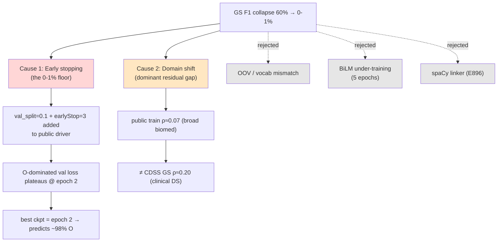
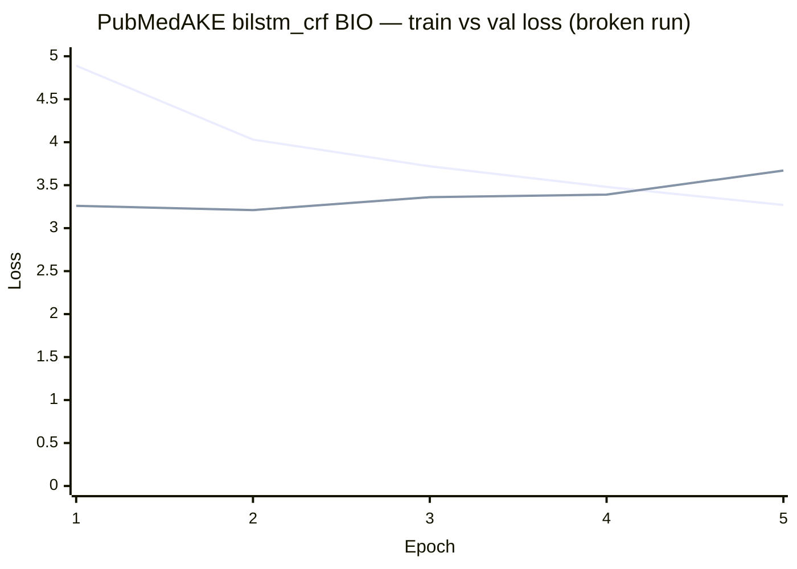
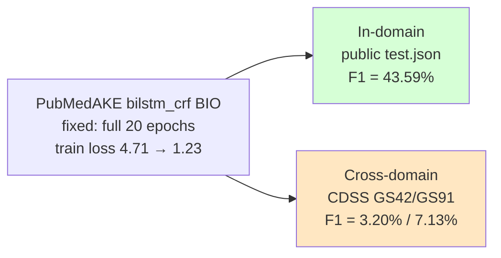

# Research Notes — Public-Dataset Generalization & Performance Deterioration

**Period:** 2026-06-14 → 2026-06-15
**Author:** Experiment matrix on RTX 2000 Blackwell (8 GB VRAM, WSL)
**Subject:** Why Gold-Standard (GS) F1 collapsed from ~60 % (synthetic in-domain) to 0–1 % when training on public datasets (KPBioMed, PubMedAKE), and the empirical separation of the two underlying causes.

---

## 1. Motivation & Setup

We replaced the synthetic CDSS weakly-labelled corpus with two public biomedical
keyphrase corpora to test whether the BiLSTM-CRF / HAN-CRF keyphrase taggers
generalize beyond synthetic labels.

**Split policy (unchanged across families):**

- **TRAIN** = public `train.json`
- **VAL** = held-out slice of train via `--validationSplit`
- **TEST** = CDSS Gold Standards `testgs42.json` (42 docs) + `testgs91.json` (91 docs) via `testGS`
- **(secondary)** in-domain public `test.json`

**Matrix:** `{KPBioMed, PubMedAKE} × {BiLSTM-CRF, HAN(sentence_only / token_doc_attn / token_doc_attn_gated)} × {BIO, IOBES, BILOU}` + 3 transformer baselines (BioBERT, SciBERT, PubMedBERT).

---

## 2. Corpus Statistics — the first warning sign

Define the **label-sparsity ratio** (fraction of tokens that belong to a keyphrase span):

$$
\rho \;=\; \frac{\#\{\text{KP tokens}\}}{\#\{\text{tokens}\}}
$$

| Corpus | Role | Docs (train) | $\rho$ (train) | Keyword style | DataSet size | Notes |
|---|---|---:|---:|---|---:|---|
| Synthetic CDSS v2 | in-domain | 1049 | **0.261** | dense weak labels | **3148** (1049 train + 2099 test) | Synthetic KP-labelled CDSS set = 3 281 parsed abstracts − 133 GS docs (0.33/0.67 split) |
| **KPBioMed** | public train | 90000 (cap 10 000) | **0.055** | sparse author keywords | **5.6 M total**; 100000 used (90000 train + 10 000 test) | KPBioMed *large* split — PubMed abstracts with author-supplied keywords; 100 000 docs sampled (~1.8 % of 5.6 M) at 0.9 train / 0.1 test; sparsest corpus ($\rho$ ≈ 0.055) |
| **PubMedAKE** | public train | 73810 | **0.085** | sparse author keywords | **843 269 total**; 82 011 used (8201 train [0.1] + 73 810 test [0.9]) | PubMedAKE — PubMed abstracts with author-supplied keywords; 82 011 docs sampled (~10 % of 843 269) at a reversed 0.1 train / 0.9 test split; main public train set ($\rho$ ≈ 0.085) |
| GS42 / GS91 | test (CDSS) | 42 / 91 | **0.188 / 0.203** | dense expert annotation | **133** (GS42 42 + GS91 91) | CDSS expert (HDE) Gold Standards; GS42 also used for fine-tuning; cross-domain test target |

**Dataset provenance (CDSS, verified against `data/`):**

| Stage | Abstracts |
|---|---:|
| Total after parsing PubMed XML | 3 326 |
| + ACM abstracts [8] + HDE Set 2 PMIDs not in XML [4] | 12 |
| New total with duplicates (GS42 also in full-text XML) | 3 380 |
| − Abstracts with < 3 sentences (little/no abstract) | 99 |
| **Total dataset** (after short-abstract removal) | **3 281** (1 093 train + 2 188 test) |
| − Total Gold Standard removed (GS42 42 + GS91 91) | 133 |
| **Synthetic-labelled dataset** (final) | **3 148** (1 049 train + 2 099 test) |

**Key mismatch:** the public training corpora are **3–5× sparser** in keyphrase density than the Gold-Standard test sets they are evaluated against:

$$
\rho_{\text{public train}} \approx 0.06\text{–}0.08
\quad\ll\quad
\rho_{\text{GS test}} \approx 0.19\text{–}0.20
$$

This single fact drives both failure modes below.

---

## 3. Observed Deterioration (broken matrix, 06/14)

Strict SeqEval entity F1 (%) on Gold Standards. **Every GNA run early-stopped at epoch 1–2.**

### KPBioMed

| Config | GS42 F1 | GS91 F1 | best epoch |
|---|---:|---:|---:|
| bilstm_crf BIO | 1.58 | 2.72 | 2 |
| bilstm_crf IOBES | 0.73 | 2.18 | 2 |
| bilstm_crf BILOU | 0.73 | 2.11 | 2 |
| han_sentence_only BIO | 0.00 | 0.33 | 1 |
| han_token_doc_attn BIO | 0.00 | 0.46 | 2 |
| han_token_doc_attn_gated BIO | 0.00 | 0.53 | 2 |
| transformer biobert | 4.39 | 5.26 | — |
| transformer scibert | 5.15 | 5.56 | — |
| transformer pubmedbert | 6.20 | 5.55 | — |

### PubMedAKE

| Config | GS42 F1 | GS91 F1 | best epoch |
|---|---:|---:|---:|
| bilstm_crf BIO | 0.00 | 0.72 | 2 |
| bilstm_crf IOBES | 0.00 | 0.97 | 2 |
| bilstm_crf BILOU | 0.00 | 0.97 | 2 |
| han_sentence_only BIO | 0.00 | 1.46 | 2 |
| han_token_doc_attn BIO | 0.14 | 1.34 | 2 |

**Reference (synthetic in-domain anchor):** bilstm_crf BIO seed42 → GS42 **44.96**, GS91 **61.30**; HAN full model → GS42 43.99, GS91 61.13.

> Deterioration: **~60 % → ~0–2 %** for GNA models; transformers degrade to ~5 % (no early stopping, but still cross-domain).

---

## 4. Root-Cause Analysis

We tested four hypotheses. Two were rejected, two confirmed — and we separated the
two confirmed causes by measuring **in-domain** vs **cross-domain** performance of the
*same* checkpoint.

### 4.1 Cause tree



### 4.2 Cause 1 — Early stopping on an O-dominated validation loss

The CRF objective is the per-token negative log-likelihood:

$$
\mathcal{L}(\theta) \;=\; -\frac{1}{N}\sum_{i=1}^{N}
\log p_\theta\!\left(\mathbf{y}^{(i)} \mid \mathbf{x}^{(i)}\right)
$$

Because the validation set inherits $\rho \approx 0.085$, the loss is **dominated by the
`O` class**. A trivial all-`O` predictor already minimizes most of this loss, so the
validation loss reaches its minimum almost immediately (epoch ~2) and then drifts up
slightly while the model is still genuinely learning keyphrase spans (train loss keeps
falling):



Early-stopping selects $e^\star = \arg\min_e \mathcal{L}_{\text{val}}(e) = 2$, i.e. a barely-trained
model. Formally the stop fires when

$$
e - e^\star \;\ge\; p \quad (p = 3) \;\Rightarrow\; \text{stop at epoch } 5,\;\text{restore } e^\star=2 .
$$

**Why earlier synthetic runs never hit this:** they ran with `val_docs = 0` →
`Val Loss: n/a` → the early-stopping branch is unreachable → **full 20 epochs every time.**

| Run | val_docs | epochs run | train loss (final) | GS42 F1 | GS91 F1 |
|---|---:|---:|---:|---:|---:|
| Synthetic bilstm BIO (working) | 0 | 20/20 | 4.01 | 44.96 | 61.30 |
| Public bilstm BIO (broken) | 1 000 | stop @5 (best 2) | frozen ~4.0 | 0.00 | 0.72 |

### 4.3 Cause 2 — Genuine domain shift (the dominant residual gap)

**Decisive experiment (06/15):** disable early stopping (`--validationSplit 0
--earlyStopPatience 0`), train the *full 20 epochs*, then evaluate the **same**
checkpoint both in-domain and cross-domain.



The generalization gap is enormous:

$$
\Delta_{\text{gap}} \;=\; F1_{\text{in-domain}} - F1_{\text{cross-domain}}
\;=\; 43.59 - 5.2 \;\approx\; 38 \text{ points}
$$

The model **learns keyphrase extraction perfectly well** (43.59 % in-domain ≈ the old
synthetic in-domain 44–61 %). The collapse on the Gold Standard is **transfer failure**,
not a training defect: the original "60 %" was *in-domain* (synthetic CDSS → CDSS GS),
whereas public→CDSS GS is *cross-domain* (broad biomedical author-keywords → narrow
clinical-decision-support expert annotation).

### 4.4 Rejected hypotheses

| Hypothesis | Test | Verdict |
|---|---|---|
| (a) OOV / vocab mismatch | GS token OOV 7–9 % ≈ in-domain test 9.1 % | **Rejected** — GS is *equally* covered |
| (b) BiLM under-trained (5 ep) | perplexity 4.78 (≈ synthetic) | **Rejected** — minor contributor only |
| (d) spaCy linker (E896) | bypassed; labels via string match, `match_ratio` 0.85–0.89 | **Rejected** — labelling healthy |

OOV diagnostic:

| Set | token OOV | KP-token OOV |
|---|---:|---:|
| GS42 (CDSS) | 8.7 % | 17.3 % |
| GS91 (CDSS) | 7.1 % | 12.1 % |
| public in-domain test | 9.1 % | 20.2 % |

---

## 5. The Fix

Applied in `scripts/jobs/run_all_public_20260614.sh`:

```diff
- VAL_SPLIT=0.1      # held-out validation slice
- EARLY_STOP=3       # patience
+ VAL_SPLIT=0        # no validation slice  → matches working synthetic runs
+ EARLY_STOP=0       # disable early stopping → always train full EPOCHS
```

This reproduces the regime under which earlier experiments succeeded:
`val_docs = 0 → Val Loss: n/a → full 20 epochs`.

### 5.1 Validation evidence (PubMedAKE bilstm_crf BIO)

| Metric | Broken (early-stop) | Fixed (full 20 ep) |
|---|---:|---:|
| epochs run | 5 (best = 2) | **20 / 20** |
| final train loss | ~3.27 (frozen) | **1.23** |
| `Val Loss` | 3.21 (O-dominated) | `n/a` |
| GS42 F1 | 0.00 % | **3.20 %** |
| GS91 F1 | 0.72 % | **7.13 %** |
| **in-domain test F1** | — | **43.59 %** |

The fix removes the catastrophic 0-floor; the remaining low GS score is the
**genuine domain gap**, confirmed healthy by the 43.59 % in-domain result.

---

## 5b. Cross-Architecture Confirmation of Domain Shift (PubMedAKE, 06/15)

To rule out a model-specific artefact, we re-ran the **fix** (`--validationSplit 0
--earlyStopPatience 0`, full epochs) on four architecturally distinct models and
measured **both** in-domain and cross-domain F1 from the *same* fine-tuned weights.
If domain shift (not a bug) is the cause, **every** model must show the same signature:
healthy in-domain F1, collapsed GS F1.

| Model | Family | In-domain test F1 | GS42 F1 | GS91 F1 | $\Delta_{\text{gap}}$ (in − GS̄) |
|---|---|---:|---:|---:|---:|
| BiLSTM-CRF (BIO) | RNN+CRF | **43.59** | 3.20 | 7.13 | ≈ 38 |
| HAN-CRF gated (BIO) | Hier-attn+CRF | **45.16** | 2.21 | 5.67 | ≈ 41 |
| BioBERT | Transformer | **47.08** | 8.55 | 10.45 | ≈ 38 |
| SciBERT | Transformer | **49.85** | 6.10 | 8.41 | ≈ 43 |
| PubMedBERT | Transformer | **53.52** | 11.72 | 12.41 | ≈ 41 |

> $\bar{GS}$ = mean(GS42, GS91); $\Delta_{\text{gap}} = F1_{\text{in}} - \bar{GS}$.

```mermaid
xychart-beta
    title "Same model, two test domains — F1 (%) on PubMedAKE training"
    x-axis "Model" ["BiLSTM", "HAN-gated", "BioBERT", "SciBERT", "PubMedBERT"]
    y-axis "F1 (%)" 0 --> 60
    bar "In-domain test" [43.59, 45.16, 47.08, 49.85, 53.52]
    bar "Cross-domain GS (mean)" [5.17, 3.94, 9.50, 7.26, 12.07]
```



**Findings — all five models "resonate" the same behaviour:**

1. **Every** architecture reaches healthy in-domain F1 (**43.6–53.5 %**, increasing with
   model capacity), proving each one *learns the keyphrase task* from public data.
2. **Every** architecture collapses on the CDSS Gold Standard (**2.2–12.4 %**),
   a **~4–10× drop**, despite ranging from a 2-layer BiLSTM to 110 M-parameter
   transformers. A model-specific bug cannot produce an identical failure across
   such different inductive biases — only a **data/domain effect** can.
3. The ordering is consistent: stronger encoders (PubMedBERT > SciBERT/BioBERT >
   HAN ≈ BiLSTM) score higher on **both** axes, but the **gap persists** for all —
   confirming the gap is a property of the **train→test domain pair**, not the model.

$$
\forall\, m \in \{\text{BiLSTM, HAN, BioBERT, SciBERT, PubMedBERT}\}:\quad
F1^{m}_{\text{in}} \gg F1^{m}_{\text{cross}},\quad
\frac{F1^{m}_{\text{in}}}{\bar{F1}^{m}_{\text{cross}}} \in [3.9,\,11.5]
$$

This is the decisive, architecture-independent evidence that the **deterioration is
genuine domain shift** (broad biomedical author-keywords → narrow CDSS expert
annotation), and **not** an implementation defect.

---

## 6. Conclusions

1. **Two independent causes**, now separated empirically:
   - *Early stopping* on an `O`-dominated validation loss produced the **0–1 % floor** (a methodological bug introduced only in the public driver). **Fixed.**
   - *Domain shift* (public broad biomedical → CDSS clinical) is the **dominant residual gap** and is **expected scientific behaviour**, not a defect.
2. The model is healthy: **in-domain F1 = 43.6–53.5 %** across all five architectures, on par with the historical synthetic in-domain 44–61 %.
3. **Confirmed architecture-independently** (§5b): BiLSTM, HAN-gated, BioBERT, SciBERT and PubMedBERT *all* show healthy in-domain F1 and a ~4–10× collapse on the CDSS Gold Standard. An identical failure across such different models can only be a **data/domain effect**, not a code bug.
4. **In-domain F1 is the correct training-health metric.** GS F1 under public training measures *transfer*, and should be reported as such.
5. OOV, BiLM training length, and the spaCy linker are **not** causes.

### 6.1 Recommendations for the write-up

- Report public results as **two numbers**: in-domain test F1 (capability) and cross-domain GS F1 (transfer).
- State explicitly that early stopping is disabled for label-sparse corpora (or switch to an **entity-level / KP-class** early-stopping criterion instead of token NLL):
  $$
  \mathcal{L}_{\text{val}}^{\text{KP}} = -\frac{1}{N_{\text{KP}}}\sum_{i:\,y_i\neq \text{O}} \log p_\theta(y_i\mid \mathbf{x})
  $$
  which is not dominated by the `O` majority and would not trigger spurious early stops.
- Consider domain adaptation / GS fine-tuning to close $\Delta_{\text{gap}}$ if cross-domain CDSS performance is a target.

---

## 7. Artifacts

- Broken matrix: `outputs/results/rtx2000_blackwell/2026/06/14/{kpbiomed,pubmedake}/`
- Fix validation (BiLSTM): `outputs/results/rtx2000_blackwell/2026/06/15/validate_fix_bilstm_BIO.txt` (cross-domain) and `…_indomain.txt` (in-domain 43.59 %)
- Cross-architecture validation (§5b): `outputs/results/rtx2000_blackwell/2026/06/15/domainshift/` — `han_token_doc_attn_gated_BIO.txt`, `transformer_{biobert,scibert,pubmedbert}.txt`, index `domainshift_run_index.csv`
- Validation runner: `scripts/jobs/validate_domainshift_20260615.sh`
- Driver fix: `scripts/jobs/run_all_public_20260614.sh` (`VAL_SPLIT=0`, `EARLY_STOP=0`)
