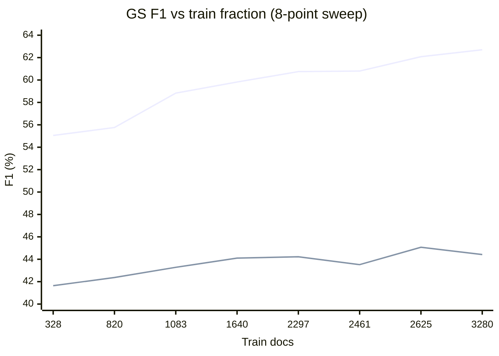

# Phase 6b — Train/Validation Split Sensitivity (extended sweep)

**Date:** 2026-06-17
**Model:** HAN-CRF (IOBES, AdamW, lr 1e-3, gated token–document attention, 8 heads) — identical to the original Phase 6 anchor.
**Environment:** conda `cdss-gpu`
**Seed:** 42 (single seed, matching original Phase 6)
**Metric:** Strict entity-level SeqEval micro-F1 (%) on the fixed external gold standards GS42 and GS91.
**Design:** Combined labeled corpus N = 3281 docs, re-split at fraction `f` with a fixed-seed (42) permutation; the pretrained LM (vocab/Word2Vec/BiLM) is held constant so only supervised-data quantity varies. Evaluation is on the fixed GS42/GS91 sets, not on the (moving) held-out test split.

## New points (this sweep)

| Train fraction | Train docs | GS42 P | GS42 R | GS42 F1 | GS91 P | GS91 R | GS91 F1 |
|---|---:|---:|---:|---:|---:|---:|---:|
| 0.10 | 328 | 34.64 | 52.21 | 41.64 | 50.77 | 60.10 | 55.05 |
| 0.25 | 820 | 35.73 | 52.05 | 42.37 | 52.11 | 59.97 | 55.76 |
| 0.50 | 1640 | 36.12 | 56.62 | 44.10 | 54.32 | 66.55 | 59.82 |
| 0.75 | 2461 | 36.11 | 54.76 | 43.52 | 56.38 | 65.98 | 60.80 |
| 1.00 | 3280 | 36.90 | 55.77 | 44.42 | 58.35 | 67.74 | 62.70 |

Note: f = 1.00 is clamped by the re-splitter to N−1 = 3280 train docs (1 held-out doc); since evaluation is on the external GS sets it represents "≈ full corpus" training.

## Merged sweep (new + original Phase 6 points)

Original Phase 6 (2026-06-12) points in *italics*.

| Train fraction | Train docs | GS42 F1 | GS91 F1 |
|---|---:|---:|---:|
| 0.10 | 328 | 41.64 | 55.05 |
| 0.25 | 820 | 42.37 | 55.76 |
| *0.33* | *1083* | *43.28* | *58.83* |
| 0.50 | 1640 | 44.10 | 59.82 |
| *0.70* | *2297* | *44.22* | *60.75* |
| 0.75 | 2461 | 43.52 | 60.80 |
| *0.80* | *2625* | *45.07* | *62.08* |
| 1.00 | 3280 | 44.42 | 62.70 |

Spread across the full 8-point sweep: GS91 ≈ 7.65 F1 (55.05 → 62.70), GS42 ≈ 3.43 F1 (41.64 → 45.07).



(Upper line = GS91, lower line = GS42.)

## Interpretation

- **GS91 increases smoothly and essentially monotonically** with training-set size across the full range (328 → 3280 docs), with no instability or collapse. The extended low-data points (0.10, 0.25) fall below the original 0.33 baseline as expected, and the high-data points (1.00) extend the curve upward, confirming the original conclusion now over a 3× wider data range.
- **GS42 rises with small, within-noise wobble** (41.64 → 45.07, range ≈ 3.4 F1). The minor non-monotonic dip at 0.75 (43.52) is consistent with the known low spread / seed noise of the abstract-only GS42 setting and does not change the trend.
- The original ~33% split remains a **conservative lower-bound operating point**, not a cherry-picked favorable one: every larger fraction matches or exceeds it on GS91.
- Gains are **recall-led on GS91** (recall climbs 60.10 → 67.74 as data grows) while precision also improves (50.77 → 58.35), indicating more training data surfaces more true spans without sacrificing precision.

## Reproduction

- Orchestrator: scripts/jobs/run_matrix_phase6b_splitsens_20260617.sh
- Re-splitter: scripts/jobs/resplit_existing_dataset.py (`--trainFraction`, `--seed 42`)
- Pipeline: src/nlp/jobs/gna_pipeline.py (`--model han_crf --mode train,testGS ...`)
- Run index: outputs/results/rtx2000_blackwell/2026/06/17/phase6b_splitsens_run_index.csv
- Per-run logs: outputs/results/rtx2000_blackwell/2026/06/17/p6_split_0{10,25,50,75}.txt, p6_split_100.txt
- Prediction dumps: outputs/results/rtx2000_blackwell/2026/06/17/predictions/p6_split_*/

Run command:

```bash
conda run -n cdss-gpu bash scripts/jobs/run_matrix_phase6b_splitsens_20260617.sh
```
