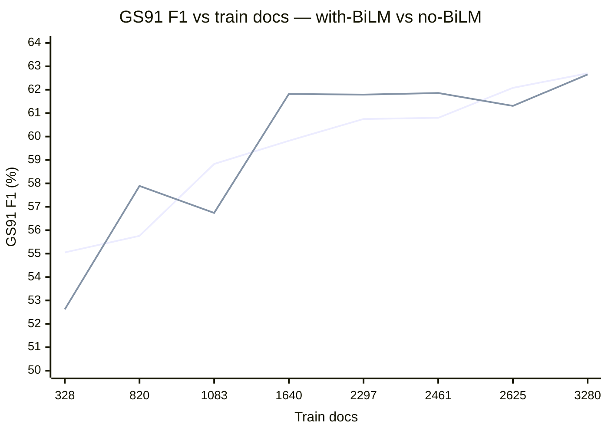

# Phase 6c — BiLM-contribution controls for split sensitivity

**Date:** 2026-06-18
**Model:** HAN-CRF (IOBES, AdamW, lr 1e-3, gated token–doc attention, 8 heads), seed 42, env `cdss-gpu`.
**Metric:** Strict entity-level SeqEval micro-F1 (%) on fixed external GS42 / GS91.
**Purpose:** Interpret why the low-data (f=0.10) GS floor in Phase 6/6b is high — is the model actually learning, and how much of the floor comes from BiLM pretraining?

Two controls were run:
- **A. Untrained baseline** at f=0.10 — pretrained LM transferred (Word2Vec + BiLM) but **0 supervised epochs / random CRF head** (`--epochs 0`).
- **B. No-BiLM sweep** over the full grid (0.10 … 1.00) with `--no-useBiLM` (Word2Vec retained, BiLM transfer removed).

## A. Untrained baseline (the true no-training floor)

| Config | Supervision | GS42 P | GS42 R | GS42 F1 | GS91 P | GS91 R | GS91 F1 |
|---|---|---:|---:|---:|---:|---:|---:|
| Untrained (BiLM, 0 epochs, random head) | none | 0.00 | 0.00 | **0.00** | 6.67 | 0.07 | **0.13** |
| Trained f=0.10 (BiLM, 20 epochs) | 328 docs | 34.64 | 52.21 | **41.64** | 50.77 | 60.10 | **55.05** |

**Conclusion.** An untrained model with a random CRF head scores ≈ 0 F1 (GS42 0.00, GS91 0.13), matching the Phase 8 random-head floor (0–7 F1). The trained f=0.10 model scores 41.64 / 55.05. The ~41–55 point gap is direct proof that the model **is genuinely learning** from the 328 supervised documents — it is not emitting random or degenerate predictions.

## B. With-BiLM vs No-BiLM across the fraction grid

GS F1 (%); "with-BiLM" = Phase 6/6b numbers; Δ = with-BiLM − no-BiLM.

| f | Train docs | wB GS42 | nB GS42 | Δ GS42 | wB GS91 | nB GS91 | Δ GS91 |
|---|---:|---:|---:|---:|---:|---:|---:|
| 0.10 | 328 | 41.64 | 41.02 | +0.62 | 55.05 | 52.62 | +2.43 |
| 0.25 | 820 | 42.37 | 42.83 | −0.46 | 55.76 | 57.89 | −2.13 |
| 0.33 | 1083 | 43.28 | 43.15 | +0.13 | 58.83 | 56.74 | +2.09 |
| 0.50 | 1640 | 44.10 | 43.72 | +0.38 | 59.82 | 61.82 | −2.00 |
| 0.70 | 2297 | 44.22 | 43.71 | +0.51 | 60.75 | 61.79 | −1.04 |
| 0.75 | 2461 | 43.52 | 43.90 | −0.38 | 60.80 | 61.86 | −1.06 |
| 0.80 | 2625 | 45.07 | 43.95 | +1.12 | 62.08 | 61.31 | +0.77 |
| 1.00 | 3280 | 44.42 | 43.16 | +1.26 | 62.70 | 62.65 | +0.05 |

Signed mean Δ: GS42 ≈ +0.40, GS91 ≈ −0.11. Magnitude stays within ±2.4 F1 and flips sign across fractions.



(Upper-ish line = with-BiLM, other = no-BiLM; the two curves interleave.)

## Interpretation (key finding)

1. **BiLM transfer contributes almost nothing** to GS performance at any data fraction: the with-BiLM and no-BiLM curves interleave, with differences within ±2.4 F1 and inconsistent sign (signed mean ≈ 0). This **corroborates the Phase 5 ablation** (`p5_no_bilm`: 44.21 / 60.93 vs full 43.99 / 61.13 at full data).
2. **Therefore the high low-data floor is NOT a BiLM effect.** Removing BiLM does not collapse the f=0.10 score (52.62 vs 55.05 GS91). The floor is sustained by the retained **pretrained Word2Vec embeddings** plus the model's capacity to fit even ~328 labeled documents in 20 supervised epochs.
3. **The model is unambiguously learning** (control A: 0 → 55 F1 once trained), so the split-sensitivity curve is valid; the modest sensitivity to data quantity reflects strong pretrained word representations, not a measurement artifact.

**Caveat for the manuscript.** To demonstrate a *large* collapse / strongly varying curve, the decisive ablation is removing **Word2Vec** as well (fully random embeddings + no BiLM, i.e. `--useRandomEmbeddings --no-useBiLM`). The no-BiLM-only ablation isolates BiLM and shows it is not the lever.

## Reproduction

- Orchestrator: scripts/jobs/run_matrix_phase6c_nobilm_and_untrained_20260618.sh
- Code: src/nlp/experiments/gna_experiment.py `train()` now supports `epochs <= 0` (saves randomly-initialized model, skips supervised training) for the untrained baseline.
- No-BiLM flag: `--no-useBiLM` (logs "skipping BiLM weight transfer (random LSTM init)" / "BiLM weights: False").
- Run index: outputs/results/rtx2000_blackwell/2026/06/18/phase6c_run_index.csv
- Logs: outputs/results/rtx2000_blackwell/2026/06/18/p6c_*.txt
- With-BiLM reference: outputs/results/rtx2000_blackwell/2026/06/17/ (Phase 6b) and the original Phase 6 (06/12) for f = 0.33/0.70/0.80.

Run command:

```bash
conda run -n cdss-gpu bash scripts/jobs/run_matrix_phase6c_nobilm_and_untrained_20260618.sh
```
