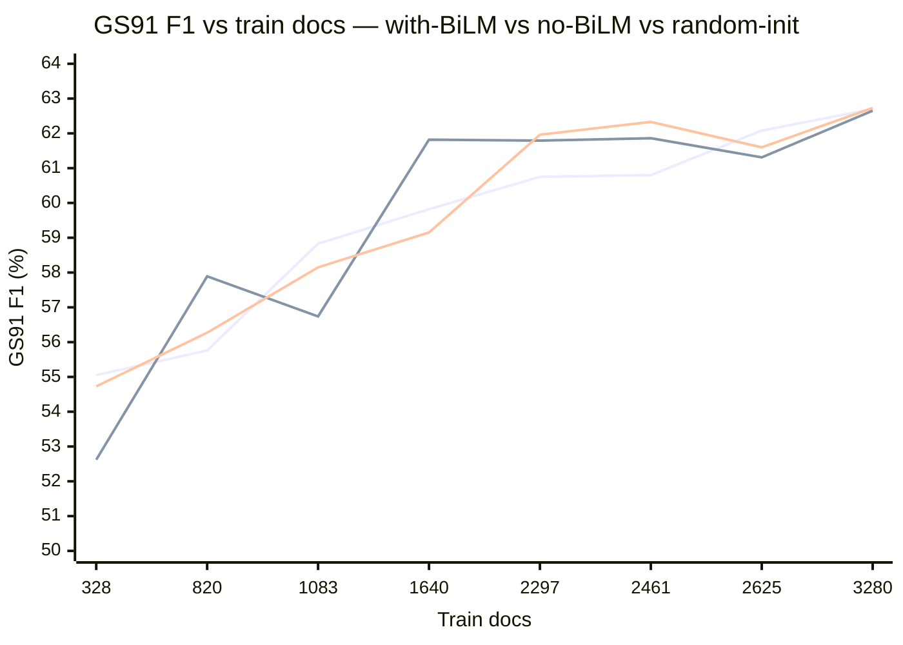

# Phase 6d — fully-random-init sweep (no pretraining) for split sensitivity

**Date:** 2026-06-18
**Model:** HAN-CRF (IOBES, AdamW, lr 1e-3, gated token–doc attention, 8 heads), seed 42, env `cdss-gpu`, 20 epochs.
**Metric:** Strict entity-level SeqEval micro-F1 (%) on fixed external GS42 / GS91.
**Ablation:** `--useRandomEmbeddings --no-useBiLM` — random word-embedding init (no Word2Vec) **and** random LSTM init (no BiLM transfer). Embeddings remain **trainable** (`hanFreezeEmbeddings=False`).
**Purpose:** Phase 6c showed BiLM contributes ~0. This removes *all* pretraining transfer to test whether the pretrained Word2Vec embeddings are what sustains the high low-data floor.

Verified per log: `Ablation: --useRandomEmbeddings set; skipping pre-trained Word2Vec embeddings (random init).` / `No pre-trained Word2Vec embeddings found` / `BiLM weights: False`.

## Three-way comparison (GS F1 %)

wB = with-BiLM (Phase 6/6b, full pretraining) · nB = no-BiLM (Phase 6c, Word2Vec only) · rnd = fully-random-init (Phase 6d, no pretraining). drop = wB − rnd.

| f | train | wB GS42 | wB GS91 | nB GS42 | nB GS91 | rnd GS42 | rnd GS91 | drop GS42 | drop GS91 |
|---|---:|---:|---:|---:|---:|---:|---:|---:|---:|
| 0.10 | 328 | 41.64 | 55.05 | 41.02 | 52.62 | 41.35 | 54.73 | +0.29 | +0.32 |
| 0.25 | 820 | 42.37 | 55.76 | 42.83 | 57.89 | 43.41 | 56.27 | −1.04 | −0.51 |
| 0.33 | 1083 | 43.28 | 58.83 | 43.15 | 56.74 | 45.08 | 58.15 | −1.80 | +0.68 |
| 0.50 | 1640 | 44.10 | 59.82 | 43.72 | 61.82 | 43.43 | 59.15 | +0.67 | +0.67 |
| 0.70 | 2297 | 44.22 | 60.75 | 43.71 | 61.79 | 44.32 | 61.96 | −0.10 | −1.21 |
| 0.75 | 2461 | 43.52 | 60.80 | 43.90 | 61.86 | 44.06 | 62.33 | −0.54 | −1.53 |
| 0.80 | 2625 | 45.07 | 62.08 | 43.95 | 61.31 | 43.86 | 61.60 | +1.21 | +0.48 |
| 1.00 | 3280 | 44.42 | 62.70 | 43.16 | 62.65 | 44.25 | 62.73 | +0.17 | −0.03 |



(All three curves interleave; no consistent separation.)

## Interpretation (key finding)

1. **Pretraining transfer is NOT the source of the high low-data floor.** Removing Word2Vec *and* BiLM (fully random init) leaves f=0.10 essentially unchanged (54.73 vs 55.05 GS91; 41.35 vs 41.64 GS42). Across all fractions the drop is within ±1.8 F1 and flips sign (signed mean ≈ 0).
2. **Mechanism:** the embeddings are **trainable** (`hanFreezeEmbeddings=False`). Whether they start from Word2Vec or random noise, 20 epochs of supervised training on the synthetic-label task converge them to similar task-specific representations, so the initialization washes out.
3. **What actually carries performance** is the **supervised training itself** on the synthetic-label task, which is learnable even from ~328 documents. The untrained baseline (Phase 6c control A: 0.00 / 0.13 F1) confirms that with no training the model scores ≈ 0; once trained, init source is largely irrelevant.
4. **Implication for the split-sensitivity study:** the modest data-quantity sensitivity reflects an easily-learnable task with trainable embeddings, not pretrained-representation transfer. The earlier Phase 5 finding (BiLM ablation ≈ full model) generalizes: **all** pretraining transfer is near-neutral under this trainable-embedding configuration.

**To actually demonstrate a large pretraining benefit / strongly varying curve**, freeze the embeddings (`--hanFreezeEmbeddings`) and rerun random-init vs Word2Vec: with frozen random embeddings the model cannot fine-tune its way back, so pretraining should then show a large, data-dependent gap. That is the recommended next control if a "pretraining matters" demonstration is needed.

## Reproduction

- Orchestrator: scripts/jobs/run_matrix_phase6d_randinit_20260618.sh
- Flags: `--useRandomEmbeddings --no-useBiLM` (all else identical to Phase 6b/6c).
- Run index: outputs/results/rtx2000_blackwell/2026/06/18/phase6d_run_index.csv
- Logs: outputs/results/rtx2000_blackwell/2026/06/18/p6d_randinit_*.txt
- Reference curves: Phase 6b (06/17) with-BiLM, Phase 6c (06/18) no-BiLM.

```bash
conda run -n cdss-gpu bash scripts/jobs/run_matrix_phase6d_randinit_20260618.sh
```
